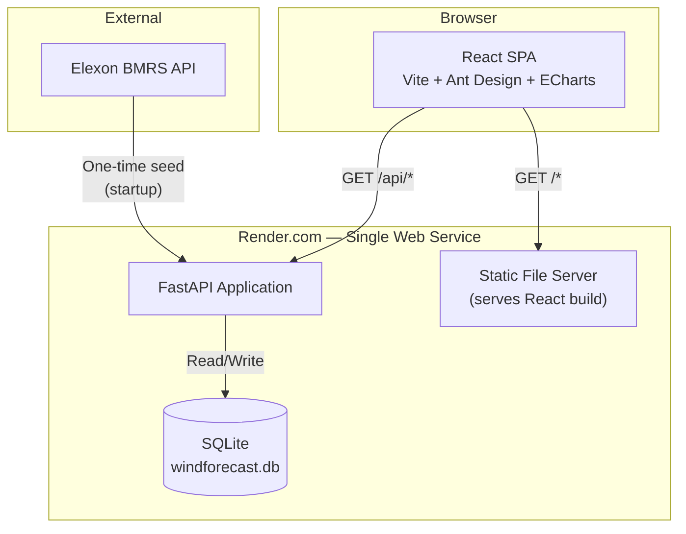
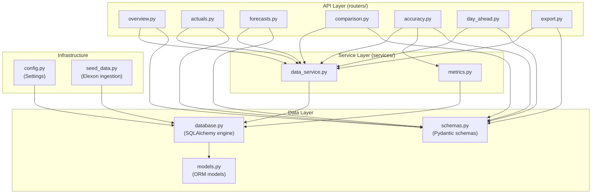
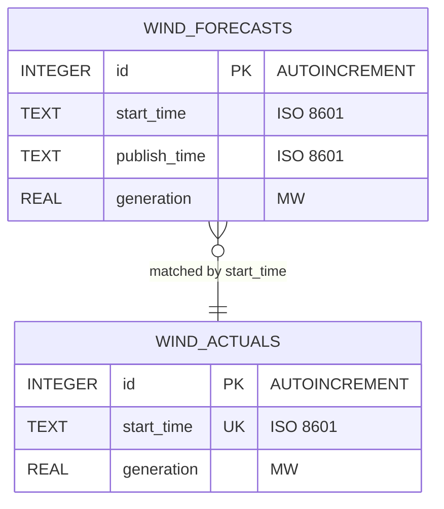
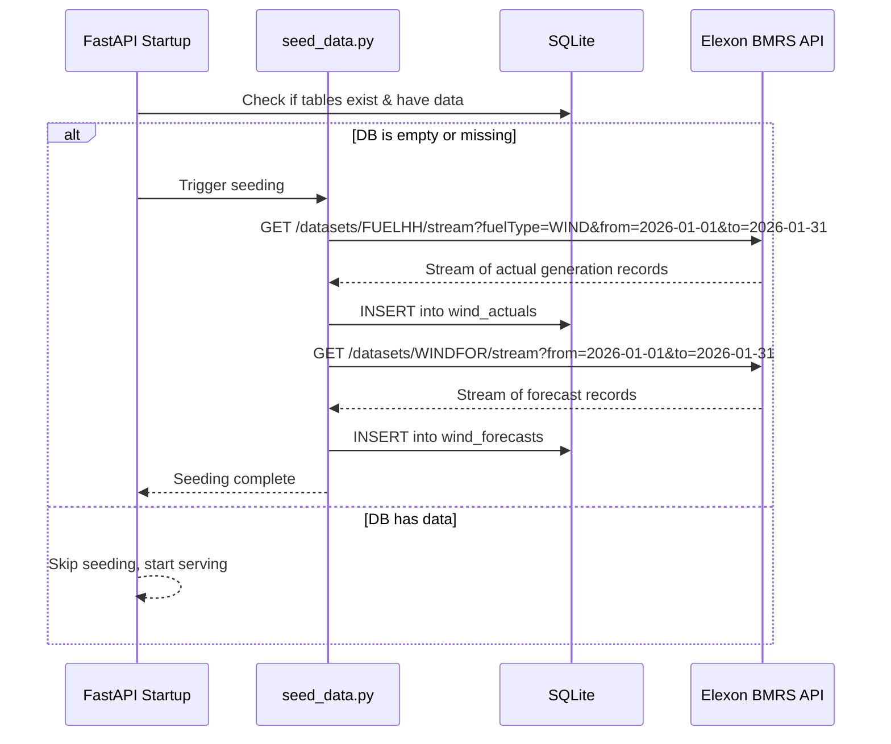
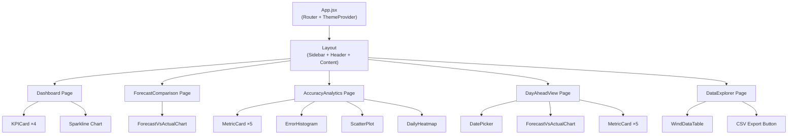
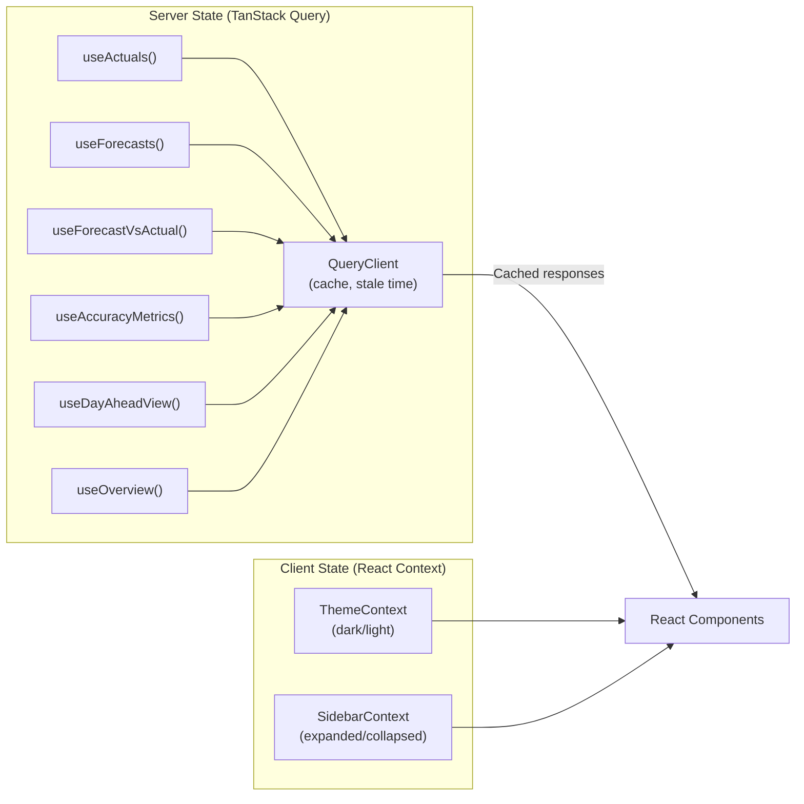
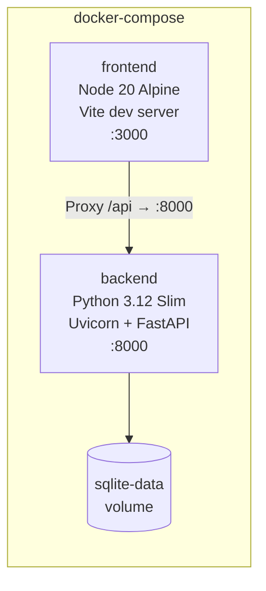
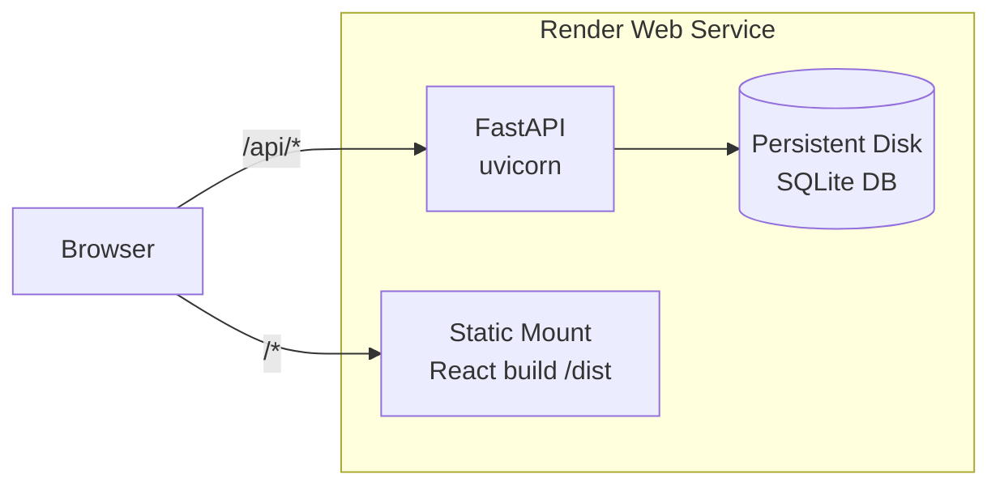
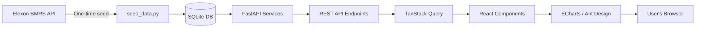

# System Architecture

> **Project**: Wind Forecast Dashboard
> **Version**: 1.0.0

---

## 1. High-Level Architecture



### Design Principles

| Principle | Application |
|---|---|
| **Single Responsibility** | Each backend router handles one resource; each React component does one thing |
| **Separation of Concerns** | Business logic in `services/`, data access in `database.py`, API layer in `routers/` |
| **Convention over Configuration** | Standardized file naming, folder structure, and API patterns |
| **Same-Origin Serving** | FastAPI serves both API and React build — no CORS needed |
| **Fail-Fast Seeding** | App checks for DB on startup; seeds automatically if missing |

---

## 2. Backend Architecture

### 2.1 Layer Diagram



### 2.2 Request Flow

```
Client Request
  → FastAPI Router (validation, path params)
    → Service Layer (business logic, query building)
      → SQLAlchemy (DB query execution)
        → SQLite (data retrieval)
      ← Raw data
    ← Processed data / computed metrics
  ← Pydantic Response (JSON serialization)
```

### 2.3 API Endpoints

| Method | Path | Router File | Service | Description |
|---|---|---|---|---|
| `GET` | `/api/overview` | `overview.py` | `data_service` | Dashboard KPIs |
| `GET` | `/api/actuals` | `actuals.py` | `data_service` | Actual wind generation |
| `GET` | `/api/forecasts` | `forecasts.py` | `data_service` | Latest forecast per period |
| `GET` | `/api/forecast-vs-actual` | `comparison.py` | `data_service` | Paired data with error |
| `GET` | `/api/accuracy-metrics` | `accuracy.py` | `metrics` | MAE, RMSE, nRMSE, Bias |
| `GET` | `/api/day-ahead-view` | `day_ahead.py` | `data_service` | D-1 forecast snapshot |
| `GET` | `/api/data-export` | `export.py` | `data_service` | CSV download |
| `GET` | `/docs` | (auto) | — | Swagger UI |

### 2.4 Database Schema



**Indexes**:
- `idx_actuals_start_time` on `wind_actuals(start_time)`
- `idx_forecasts_start_time` on `wind_forecasts(start_time)`
- `idx_forecasts_publish_time` on `wind_forecasts(publish_time)`
- `UNIQUE(start_time, publish_time)` on `wind_forecasts`

### 2.5 Data Seeding Flow



---

## 3. Frontend Architecture

### 3.1 Component Tree



### 3.2 State Management



**Why TanStack Query?**
- Automatic caching (January 2026 data never changes → `staleTime: Infinity`)
- Built-in loading / error states
- Deduplication of concurrent requests
- Zero boilerplate compared to manual `useEffect` + `useState`

### 3.3 Routing

| Path | Page Component | Description |
|---|---|---|
| `/` | `Dashboard` | Overview with KPIs and sparkline |
| `/forecast-comparison` | `ForecastComparison` | Overlay chart with data zoom |
| `/accuracy` | `AccuracyAnalytics` | Metrics, histogram, scatter, heatmap |
| `/day-ahead` | `DayAheadView` | D-1 decision simulation |
| `/data` | `DataExplorer` | Table + CSV export |

---

## 4. Docker Architecture

### 4.1 Local Development



**Two containers only** — no database container needed (SQLite is embedded).

### 4.2 Production (Render.com)



Single service serves everything. React build is created during the Render build step and mounted as static files.

---

## 5. Data Flow Summary



---

## 6. Security Considerations

| Concern | Mitigation |
|---|---|
| Elexon API | Public API, no auth required — fetched once at startup |
| SQL Injection | SQLAlchemy ORM parameterizes all queries |
| XSS | React auto-escapes JSX output |
| CORS | Not needed — same-origin serving |
| Data Sensitivity | Public energy data only — no PII |
| Rate Limiting | One-time fetch — no ongoing API calls |
