# Implementation Plan

> **Project**: Wind Forecast Dashboard
> **Budget**: 16 hours
> **Approach**: Phased delivery — each phase produces a working increment

---

## Phase Overview

```mermaid
gantt
    title 16-Hour Implementation Plan
    dateFormat HH:mm
    axisFormat %H:%M

    section Phase 1 — Foundation
    Project scaffolding           :p1a, 00:00, 1h
    Docker setup                  :p1b, after p1a, 1h
    Data seeder (Elexon API)      :p1c, after p1b, 1h

    section Phase 2 — Backend API
    DB models + schemas           :p2a, after p1c, 0.5h
    Core endpoints                :p2b, after p2a, 1.5h
    Metrics service               :p2c, after p2b, 1h

    section Phase 3 — Frontend Core
    Layout + sidebar + routing    :p3a, after p2c, 1.5h
    Theme system (dark/light)     :p3b, after p3a, 0.5h
    Dashboard page                :p3c, after p3b, 1h
    Forecast vs Actual chart      :p3d, after p3c, 1h

    section Phase 4 — Analytics + Views
    Accuracy Analytics page       :p4a, after p3d, 1.5h
    Day-Ahead Decision view       :p4b, after p4a, 1h
    Data table + CSV export       :p4c, after p4b, 0.5h

    section Phase 5 — Polish + Deploy
    Theme polish + responsive     :p5a, after p4c, 1h
    Render.com deployment         :p5b, after p5a, 1h
    README + final review         :p5c, after p5b, 1h
```

---

## Phase 1: Foundation (3 hours)

**Goal**: Working Docker setup that seeds data from Elexon and starts a bare FastAPI server.

### Deliverables

| Task | Time | Output |
|---|---|---|
| Init project structure, `README.md` stub | 20 min | Folder scaffold |
| Set up `backend/` with FastAPI, `requirements.txt`, `Dockerfile` | 20 min | Working Python container |
| Set up `frontend/` with Vite + React + Ant Design, `Dockerfile` | 20 min | Working Node container |
| Write `docker-compose.yml` (2 services + volume) | 15 min | `docker-compose up` works |
| Implement `database.py` (SQLAlchemy + SQLite) | 15 min | DB engine ready |
| Implement `models.py` (wind_actuals, wind_forecasts) | 15 min | ORM models |
| Implement `seed_data.py` (Elexon FUELHH + WINDFOR fetch) | 45 min | Auto-seed on startup |

### Exit Criteria
- [ ] `docker-compose up` starts both containers
- [ ] SQLite DB is created and populated with January 2026 data
- [ ] FastAPI responds at `http://localhost:8000/docs`
- [ ] Vite dev server responds at `http://localhost:3000`

---

## Phase 2: Backend API (3 hours)

**Goal**: All API endpoints working and documented via Swagger.

### Deliverables

| Task | Time | Output |
|---|---|---|
| Define Pydantic schemas (`schemas.py`) | 20 min | Response models |
| `data_service.py` — shared query helpers | 20 min | Reusable data access |
| `GET /api/overview` | 15 min | Dashboard KPIs |
| `GET /api/actuals` | 15 min | Actuals time series |
| `GET /api/forecasts` | 20 min | Latest forecast per period |
| `GET /api/forecast-vs-actual` | 20 min | Paired data with error |
| `metrics.py` — MAE, RMSE, nRMSE, Bias, Max Error | 30 min | Metrics computation |
| `GET /api/accuracy-metrics` | 15 min | Metrics endpoint |
| `GET /api/day-ahead-view` | 20 min | D-1 decision data |
| `GET /api/data-export` | 15 min | CSV download |

### Exit Criteria
- [ ] All 7 endpoints return correct data (verified via Swagger)
- [ ] Metrics match manual calculation for a sample day
- [ ] Date range filtering (`start`, `end` params) works
- [ ] CSV export downloads correctly

---

## Phase 3: Frontend Core (4 hours)

**Goal**: Navigable app with sidebar, theme toggle, Dashboard, and Forecast vs Actual chart.

### Deliverables

| Task | Time | Output |
|---|---|---|
| Install dependencies (antd, echarts, tanstack-query, react-router) | 15 min | `package.json` |
| `ThemeContext.jsx` + `variables.css` (CSS custom properties) | 30 min | Dark/light system |
| `Sidebar.jsx` (collapsible, icons, active state) | 30 min | Navigation |
| `Header.jsx` (title, theme toggle) | 15 min | Top bar |
| `App.jsx` (layout + routing) | 15 min | SPA structure |
| `api/client.js` + `hooks/useWindData.js` (TanStack Query) | 30 min | Data fetching |
| `KPICard.jsx` component | 15 min | Reusable metric card |
| `Dashboard.jsx` page (KPIs + sparkline) | 30 min | Home page |
| `ForecastVsActualChart.jsx` (ECharts overlay) | 45 min | Core chart |
| `ForecastComparison.jsx` page | 15 min | Chart page |

### Exit Criteria
- [ ] Sidebar navigates between pages
- [ ] Theme toggle switches dark ↔ light and persists
- [ ] Dashboard shows live KPIs from the API
- [ ] Forecast vs Actual chart renders with data zoom

---

## Phase 4: Analytics & Decision View (3 hours)

**Goal**: All 5 views complete and functional.

### Deliverables

| Task | Time | Output |
|---|---|---|
| `MetricCard.jsx` (large stat with label + trend) | 15 min | Reusable component |
| `ErrorHistogram.jsx` (ECharts bar chart) | 20 min | Error distribution |
| `ScatterPlot.jsx` (ECharts scatter + diagonal) | 20 min | Forecast vs Actual scatter |
| `DailyHeatmap.jsx` (ECharts heatmap) | 20 min | Daily accuracy view |
| `AccuracyAnalytics.jsx` page (compose all above) | 15 min | Analytics page |
| `DayAheadView.jsx` page (date picker + chart + metrics) | 45 min | Decision simulation |
| `WindDataTable.jsx` (Ant Design Table + filters) | 30 min | Data table |
| `DataExplorer.jsx` page (table + CSV export button) | 15 min | Data page |

### Exit Criteria
- [ ] Accuracy page shows all 5 metrics correctly
- [ ] Histogram, scatter, and heatmap render with real data
- [ ] Day-Ahead view filters forecasts by 11:00 D-1 gate closure
- [ ] Data table sorts, filters, and exports to CSV

---

## Phase 5: Polish & Deploy (3 hours)

**Goal**: Production-quality visuals, deployed and documented.

### Deliverables

| Task | Time | Output |
|---|---|---|
| Dark theme polish (card borders, hover states, shadows) | 30 min | Refined UI |
| Light theme polish (contrast, readability) | 15 min | Refined UI |
| Responsive tweaks (sidebar collapse, chart resize) | 15 min | Desktop-friendly |
| Build React for production (`npm run build`) | 10 min | `dist/` folder |
| Configure FastAPI to serve static build | 15 min | Same-origin serving |
| Deploy to Render.com (web service + persistent disk) | 30 min | Live URL |
| Verify deployment (data seeding, all pages) | 15 min | Smoke test |
| Write `README.md` (setup, architecture, live URL) | 30 min | Documentation |
| Final review and bug fixes | 20 min | Clean release |

### Exit Criteria
- [ ] App looks polished in both themes
- [ ] Live URL is accessible and functional
- [ ] `docker-compose up` still works locally
- [ ] README is comprehensive

---

## Risk Mitigation

| Risk | Probability | Impact | Mitigation |
|---|---|---|---|
| Elexon API down / rate-limited | Low | High | Commit a pre-fetched JSON fallback in `backend/data/` |
| Elexon API response format changes | Low | Medium | Pin expected fields in schema; fail loudly in seeder |
| ECharts learning curve | Medium | Medium | Start with simple line chart; add features incrementally |
| 16-hour overrun | Medium | High | Phases are ordered by priority — if time runs out, cut Phase 5 polish items |
| Render.com free tier cold starts | High | Low | Document expected cold start delay in README |

---

## Decision Log

| # | Decision | Rationale | Alternatives Considered |
|---|---|---|---|
| D1 | SQLite over PostgreSQL | ~1,500 rows; no separate service; trivially portable | PostgreSQL (overkill for demo) |
| D2 | Single Render.com deployment | One service serves all; no CORS; simpler | Vercel + Render split |
| D3 | ECharts over Recharts | Best visuals out-of-the-box for energy dashboards | Recharts, Chart.js, D3 |
| D4 | Ant Design over MUI | Enterprise/data-dense aesthetic; built-in dark theme | MUI, shadcn/ui |
| D5 | TanStack Query over Redux | Perfect for server state caching; minimal boilerplate | Redux Toolkit, plain hooks |
| D6 | Exclude MAPE | Blows up when wind generation ≈ 0 | Include with caveat |
| D7 | No tests (16h budget) | Maximize feature delivery within time constraint | pytest + Vitest |
